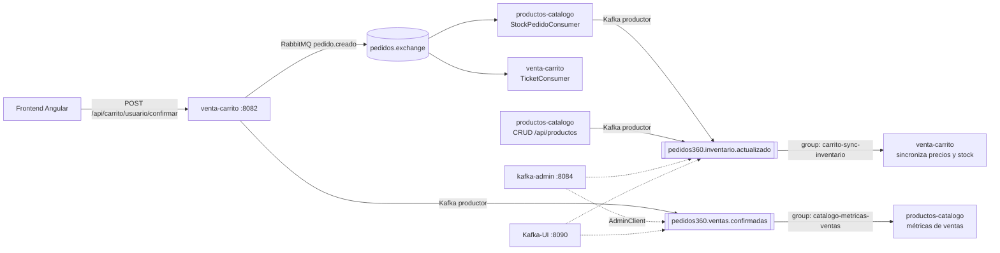

# Casos de uso Kafka – Pedidos360 (EP3)

Este documento define **qué flujos del sistema se implementan con Kafka, por qué, y cómo conviven con RabbitMQ**.
Es la base para la configuración de tópicos, los DTO, los productores/consumidores y el microservicio `kafka-admin`.

## 1. Criterio de diseño: ¿RabbitMQ o Kafka?

El sistema ya usa RabbitMQ (EP2) y **esa integración no se modifica**. Kafka se agrega para lo que RabbitMQ no resuelve bien:

| | RabbitMQ (se mantiene) | Kafka (nuevo) |
|---|---|---|
| Rol | **Cola de trabajo / comandos**: "haz esto una vez" | **Log de eventos / streaming**: "esto pasó" |
| Mensaje tras consumirse | Se elimina (ACK) | **Se conserva** según la retención; varios grupos pueden leerlo y releerlo |
| Uso en Pedidos360 | Descontar stock y generar ticket (`pedido.creado`) | Analítica de ventas y sincronización del estado del inventario |
| Errores | DLX + DLQ por cola | Reintentos con backoff + tópico `.DLT` por tópico |

**Regla:** una tarea que debe ejecutarse **exactamente una vez** se mantiene en RabbitMQ. Un **hecho de negocio** que pueden necesitar muchos interesados, ahora o a futuro (analítica, auditoría, caches), va a Kafka.

## 2. Arquitectura



Clúster local: **3 brokers + Zookeeper**, por eso los tópicos usan factor de replicación 3. RabbitMQ también corre como **clúster de 3 nodos**, y los microservicios reciben la lista de los 3 (`spring.rabbitmq.addresses`).

### Infraestructura (Docker Compose)

| Archivo | Levanta | Acceso |
|---|---|---|
| [docker/rabbitmq-cluster.yml](../../docker/rabbitmq-cluster.yml) | Clúster RabbitMQ: `rabbitmq1`, `rabbitmq2`, `rabbitmq3` (peer discovery `classic_config`, cookie compartida, `pause_minority`) | AMQP 5672/5673/5674 · UI http://localhost:15672 |
| [docker/kafka.yml](../../docker/kafka.yml) | Zookeeper + `kafka1`, `kafka2`, `kafka3` + `kafka-init`, que ejecuta [crear-topicos.sh](../../docker/kafka/crear-topicos.sh) | localhost:9092/9093/9094 |
| [docker/kafka-ui.yml](../../docker/kafka-ui.yml) | Kafka-UI con métricas JMX de los brokers (incluye `kafka.yml`) | http://localhost:8090 |
| [docker-compose.yml](../../docker-compose.yml) | Todo lo anterior + MySQL | `docker compose up -d` |

Los tópicos se crean de dos formas que no se contradicen: el script de infraestructura `crear-topicos.sh` (idempotente) y los beans `NewTopic` de cada microservicio. Cada servicio declara el tópico que produce y el DLT del tópico que consume.

---

## 3. Caso de uso 1 – Analítica de ventas confirmadas

**Tópico:** `pedidos360.ventas.confirmadas`

| Elemento | Definición |
|---|---|
| Problema que resuelve | El negocio quiere saber **qué productos se venden más** (unidades y monto) sin consultar la BD transaccional del carrito, que se vacía al confirmar. |
| Productor | `venta-carrito`, al confirmar un pedido (`CarritoService.confirmarPedido`). Publica **después del commit** de la transacción: si Kafka falla, la venta no se pierde (se registra en el log). |
| Clave (key) | `usuarioId`: los eventos de un mismo cliente van a la misma partición y conservan su orden. |
| Consumidor | `productos-catalogo`, `@KafkaListener` en el grupo **`catalogo-metricas-ventas`** con `concurrency = 3`, es decir, un hilo por partición (balanceo de carga). |
| Procesamiento | Por cada ítem acumula `unidadesVendidas` y `montoVendido` por producto en la tabla `metricas_venta_producto`. Es **idempotente**: guarda el `eventoId` procesado para no contar dos veces una venta reentregada. |
| Salida visible | `GET /api/productos/mas-vendidos?top=5`, que el frontend muestra como sección "Más vendidos". |
| Por qué Kafka | La retención de 7 días permite **reprocesar** (por ejemplo, reconstruir las métricas desde cero reseteando el offset del grupo) y que otros grupos se sumen después (auditoría, BI) sin tocar al productor. |

**Configuración del tópico**

| Parámetro | Valor | Justificación |
|---|---|---|
| `partitions` | 3 | Paraleliza el consumo: 3 consumidores del grupo |
| `replication.factor` | 3 | Una copia por broker |
| `min.insync.replicas` | 2 | Con `acks=all` tolera la caída de 1 broker sin perder ventas |
| `cleanup.policy` | `delete` | Son hechos históricos; se borran por antigüedad |
| `retention.ms` | `604800000` (7 días) | Ventana para reprocesar y auditar |

---

## 4. Caso de uso 2 – Sincronización del estado del inventario

**Tópico:** `pedidos360.inventario.actualizado`

| Elemento | Definición |
|---|---|
| Problema que resuelve | `venta-carrito` guarda el precio de cada ítem al momento de agregarlo. Si el catálogo cambia el precio o el producto se agota, el carrito muestra datos **desactualizados**. |
| Productores | `productos-catalogo` en dos puntos: **(a)** al descontar stock por un pedido (dentro de `StockPedidoConsumer`, que sigue llegando por RabbitMQ) y **(b)** al crear, actualizar o eliminar un producto vía `/api/productos`. |
| Clave (key) | `productoId`: todos los cambios de un producto quedan en orden en la misma partición, requisito para la compactación. |
| Consumidor | `venta-carrito`, `@KafkaListener` en el grupo **`carrito-sync-inventario`**. |
| Procesamiento | Actualiza `precioUnitario` y `total` de los ítems en carrito de ese producto y marca `disponible = false` si `stockActual = 0`. |
| Salida visible | `GET /api/carrito/{usuarioId}` devuelve precios vigentes y el aviso "sin stock"; el frontend lo muestra. |
| Por qué Kafka | Con **compactación** el tópico se comporta como una tabla con el *último estado de cada producto*: un servicio nuevo puede leerlo desde el inicio y reconstruir el inventario completo. RabbitMQ no ofrece esto. |

**Configuración del tópico**

| Parámetro | Valor | Justificación |
|---|---|---|
| `partitions` | 3 | Distribuye los productos por clave |
| `replication.factor` | 3 | Una copia por broker |
| `min.insync.replicas` | 2 | Tolera la caída de 1 broker |
| `cleanup.policy` | `compact` | Solo importa el último estado por `productoId` |
| `min.compaction.lag.ms` | `60000` | Deja 1 min a los consumidores antes de compactar |
| `segment.ms` | `3600000` (1 h) | Segmentos cortos para que la compactación sea visible en la demo |
| `delete.retention.ms` | `86400000` (1 día) | Tiempo que se conservan los tombstones de productos eliminados |

---

## 5. Manejo de errores (ambos tópicos)

| Situación | Tratamiento |
|---|---|
| JSON mal formado (no deserializa) | `ErrorHandlingDeserializer`: no rompe el listener; va **directo al DLT**, sin reintentos |
| Payload inválido (falta `productoId`, cantidad ≤ 0, etc.) | Validación del DTO con `@Valid`. Es un error no recuperable: **DLT** sin reintentos y log con el contenido |
| Error recuperable (BD caída momentáneamente) | `DefaultErrorHandler` con **3 reintentos, backoff exponencial 1 s → 2 s → 4 s**; si persiste, va al DLT |
| Evento duplicado | Idempotencia por `eventoId` |

Tópicos DLT: `pedidos360.ventas.confirmadas.DLT` y `pedidos360.inventario.actualizado.DLT` (1 partición, RF 3, `delete`, retención 14 días). Cada mensaje enviado al DLT queda registrado en el log con tópico, partición, offset y causa.

## 6. Microservicio `kafka-admin` (puerto 8084)

Equivalente a `rabbitmq-admin`, usa `AdminClient` y está protegido con JWT de Azure AD:

| Operación | Endpoint |
|---|---|
| Listar tópicos | `GET /api/kafka/topicos` |
| Detalle (particiones, réplicas, líderes, ISR) | `GET /api/kafka/topicos/{nombre}` |
| Crear tópico con configuraciones | `POST /api/kafka/topicos` |
| Aumentar particiones | `PATCH /api/kafka/topicos/{nombre}/particiones` |
| Ver / modificar configuraciones (retención, cleanup…) | `GET`/`PUT /api/kafka/topicos/{nombre}/configuraciones` |
| Eliminar tópico | `DELETE /api/kafka/topicos/{nombre}` |
| Listar consumer groups | `GET /api/kafka/grupos` |
| Detalle de un grupo (miembros, offsets y lag) | `GET /api/kafka/grupos/{groupId}` |
| Resetear offsets de un grupo (reprocesar) | `POST /api/kafka/grupos/{groupId}/reset-offsets` |
| Eliminar un consumer group | `DELETE /api/kafka/grupos/{groupId}` |
| Listar brokers del clúster | `GET /api/kafka/cluster` |
| Restablecer una configuración a su valor por defecto | `DELETE /api/kafka/topicos/{nombre}/configuraciones/{clave}` |

Reglas de protección: no permite reducir particiones (Kafka no lo admite), crear tópicos con más réplicas que brokers activos, eliminar tópicos internos (`__*`) ni resetear offsets de un grupo con consumidores activos. Swagger UI: http://localhost:8084/swagger-ui.html.

## 7. Resumen de tópicos y grupos

| Tópico | Productor | Consumer group → servicio | Key | Part. | RF | Política |
|---|---|---|---|---|---|---|
| `pedidos360.ventas.confirmadas` | venta-carrito | `catalogo-metricas-ventas` → productos-catalogo | usuarioId | 3 | 3 | delete, 7 d |
| `pedidos360.inventario.actualizado` | productos-catalogo | `carrito-sync-inventario` → venta-carrito | productoId | 3 | 3 | compact |
| `*.DLT` | error handlers | (inspección en Kafka-UI) | original | 1 | 3 | delete, 14 d |

El formato JSON de cada mensaje se define en [modelo-mensajes.md](modelo-mensajes.md) (tarea 1.3).

---

## 8. Implementación: dónde está cada cosa

| Pieza | productos-catalogo | venta-carrito |
|---|---|---|
| Configuración del cliente (bootstrap, serializers, acks=all, idempotencia, `ErrorHandlingDeserializer`, `CooperativeStickyAssignor`) | `application.yml` → `spring.kafka` | `application.yml` → `spring.kafka` |
| Tópicos, grupos y reintentos (único lugar con nombres) | `application.yml` → `pedidos360.kafka` + `KafkaTopicosProperties` | ídem |
| Declaración de tópicos y manejo de errores (backoff + DLT + logs) | `config/KafkaConfig` | `config/KafkaConfig` |
| DTO | `dto/kafka/InventarioActualizadoEvent`, `VentaConfirmadaEvent` | `dto/kafka/VentaConfirmadaEvent`, `InventarioActualizadoEvent` |
| Productor | `messaging/kafka/inventario/KafkaInventarioEventPublisher` (tras el commit) | `messaging/kafka/ventas/KafkaVentaEventPublisher` (tras el commit) |
| Consumidor (`@KafkaListener`, solo mensajería) | `messaging/kafka/ventas/VentasConfirmadasConsumer` | `messaging/kafka/inventario/InventarioActualizadoConsumer` |
| Lógica de negocio (sin Kafka) | `service/MetricasVentaService` (idempotencia por `eventoId`, `@Version`) | `service/SincronizacionInventarioService` (descarta eventos atrasados) |
| Endpoint resultante | `GET /api/productos/mas-vendidos` | `GET /api/carrito/{usuarioId}` (campos `disponible`, `actualizadoDesdeInventario`); confirmar con productos agotados → **409** |

Los servicios de negocio dependen de interfaces (`InventarioEventPublisher`, `VentaEventPublisher`), no de `KafkaTemplate`, igual que el productor RabbitMQ (`PedidoEventPublisher`). La integración RabbitMQ solo cambió en dos puntos: `StockPedidoConsumer` ahora pasa el `pedidoId` al descontar stock (para trazarlo en el evento Kafka), y la conexión usa los 3 nodos del clúster.

## 9. Cómo levantar y probar en local

```bash
docker compose up -d                       # clúster RabbitMQ, Kafka (3 brokers), Kafka-UI y MySQL
cd back-app && mvn clean package           # compila y ejecuta los tests de los 4 microservicios
java -jar productos-catalogo/target/productos-catalogo-0.0.1-SNAPSHOT.jar   # :8081
java -jar venta-carrito/target/venta-carrito-0.0.1-SNAPSHOT.jar             # :8082
java -jar rabbitmq-admin/target/rabbitmq-admin-0.0.1-SNAPSHOT.jar           # :8083
java -jar kafka-admin/target/kafka-admin-0.0.1-SNAPSHOT.jar                 # :8084

# Prueba del administrador contra el clúster real (crea, modifica y elimina un tópico temporal)
mvn -pl kafka-admin test -Dkafka.local=true -Dtest=KafkaAdminServiceClusterLocalTest
```

> Si el puerto 3306 del PC está ocupado (por ejemplo, por un MySQL dentro de WSL), levantar MySQL en otro puerto: `MYSQL_PUERTO=3307 docker compose up -d` y ejecutar los servicios con `DB_PORT=3307`.

## 10. Verificación realizada (11/11/2026)

| # | Prueba | Resultado |
|---|---|---|
| 1 | `pedido.creado` publicado en RabbitMQ (6 "Hamburguesa Doble" + 2 bebidas) | RabbitMQ sigue funcionando: stock descontado (ACK) y ticket generado (ACK). Kafka publicó `STOCK_DESCONTADO` de cada producto (key = productoId) y `venta-carrito` marcó `disponible = false` en los 2 carritos con el producto agotado |
| 2 | Dos ventas en `pedidos360.ventas.confirmadas` + **la misma venta repetida** | Métricas correctas (Hamburguesa Clásica: 3 unidades en 2 pedidos). El duplicado se ignoró por idempotencia |
| 3 | Dos ventas del mismo producto procesadas a la vez por hilos distintos del grupo | Conflicto real al crear la fila de métricas → **reintento automático** a 1 s → éxito |
| 4 | Texto que no es JSON · venta con cantidades negativas · evento de inventario con key ≠ productoId | Los 3 van **directo al DLT** sin reintentos, con cabeceras `kafka_dlt-*`. Lag 0: la partición no se bloquea |
| 5 | Venta válida con MySQL detenido | 3 reintentos con backoff de 1 s, 2 s y 4 s → DLT. El mensaje queda en `.DLT` para reprocesarlo |
| 6 | Consumer groups | `catalogo-metricas-ventas` y `carrito-sync-inventario`: 3 consumidores cada uno, 1 partición por consumidor |
| 7 | `kafka-admin` contra el clúster real | Crear (2 particiones, RF 3, configs) · duplicado → error · RF 5 > 3 brokers → rechazo · modificar/restablecer `retention.ms` · 2→4 particiones (no permite reducir) · offsets y lag de un grupo · reset a EARLIEST (lag 6) · eliminar grupo · no elimina `__consumer_offsets` · eliminar tópico |
| 8 | Seguridad | Sin JWT, todos los endpoints de `kafka-admin` y `/api/productos/mas-vendidos` responden **401** |
| 9 | Tests unitarios | 61 tests en verde (catálogo 19 · carrito 16 · rabbitmq-admin 15 · kafka-admin 11). El 13/11 se agregaron 32 tests de productores, consumidores, servicios de negocio y manejo de errores Kafka: **93 en verde** (catálogo 35 · carrito 32 · rabbitmq-admin 15 · kafka-admin 11) |

## 11. Frontend: datos de Kafka visibles para el usuario (12/11/2026)

| Vista | Qué muestra | Origen Kafka | Archivos (`front-app/src/app/`) |
|---|---|---|---|
| **🏆 Más vendidos** (`/mas-vendidos`, protegida con `MsalGuard`) | Ranking top 3/5/10 con unidades, pedidos, monto, última venta y barra proporcional; estados de carga, vacío y error | `pedidos360.ventas.confirmadas` → `productos-catalogo` → `GET /api/productos/mas-vendidos?top=N` (con JWT) | `pages/mas-vendidos/`, `services/metricas.ts`, `components/models/metrica-venta.ts` |
| **Carrito: aviso "Sin stock"** | Etiqueta "Sin stock" en cada item agotado, aviso general, botón *Continuar compra* deshabilitado y total sin los agotados. Si el backend igual responde **409**, se informa y se recarga el carrito. El precio mostrado es el vigente del backend (también lo actualiza Kafka) | `pedidos360.inventario.actualizado` → `venta-carrito` (campo `disponible` de cada item) | `pages/carrito/`, `services/carrito.ts`, `components/models/carrito.ts` |

Pruebas unitarias del frontend (Vitest, `npx ng test --watch=false`): **12 archivos, 22 tests en verde**. Las nuevas cubren la llamada a `mas-vendidos` con `top`, el ranking, los estados vacío y error, el mapeo de `disponible` y del precio vigente, el bloqueo de la compra con productos agotados y la respuesta 409.

## 12. Despliegue en AWS EC2 (13/11/2026)

`terraform apply` crea VPC, subred pública, security group (solo la IP de quien despliega) y una EC2 **t3.large** (8 GB, swap 2 GB). Al arrancar, la instancia clona el repositorio, compila los 4 microservicios con Maven en un contenedor y ejecuta `infraestructura/docker-compose.yml`, que **reutiliza los mismos archivos de `docker/`** del entorno local:

| Componente | Contenedores | Acceso |
|---|---|---|
| Clúster RabbitMQ | `rabbitmq1..3` | `:15672` |
| Kafka | `zookeeper`, `kafka1..3`, `kafka-init` (crea los tópicos y termina con código 0) | red interna `kafkaN:29092` |
| Kafka-UI | `kafka-ui` | `:8090` |
| Base de datos | `mysql-server` | red interna |
| Microservicios | `productos-catalogo`, `venta-carrito`, `rabbitmq-admin`, `kafka-admin` | `:8081` a `:8084` |

Los microservicios usan `RABBITMQ_ADDRESSES=rabbitmq1:5672,rabbitmq2:5672,rabbitmq3:5672` y `KAFKA_BOOTSTRAP_SERVERS=kafka1:29092,kafka2:29092,kafka3:29092`; el heap de cada JVM está acotado y se fuerza IPv4 (`-Djava.net.preferIPv4Stack=true`), porque sin IPv6 en la red de Docker la JVM no lograba leer la configuración OIDC de Azure AD y el microservicio no arrancaba.

Verificación: 14 contenedores (13 *Up*/*healthy* + `kafka-init` *Exited (0)*), consumer groups con una partición por consumidor, `ping` 200, endpoints protegidos 401 sin JWT, Kafka-UI y RabbitMQ 200, preflight CORS desde `http://localhost:4200` 200. Uso de memoria ≈ 3,5 GB. El frontend se ejecuta en `http://localhost:4200` (redirect URI registrado en Azure AD).

**API Manager.** `infraestructura/terraform/api_gateway.tf` crea un AWS API Gateway (HTTP API, integraciones `HTTP_PROXY`) que enruta `/api/productos/**` → 8081, `/api/carrito/**` → 8082, `/api/rabbitmq/**` → 8083 y `/api/kafka/**` → 8084; el frontend llama a esa única URL. El security group abre 8081-8084 solo a los rangos de IP que AWS publica para API Gateway en `us-east-1` (`data.aws_ip_ranges`). Verificado: `ping` 200 a través del gateway, endpoints protegidos de las 4 rutas 401 sin JWT y preflight CORS desde `http://localhost:4200` 200 con `Authorization` permitido. Este gateway reemplaza la URL heredada de la EP2, que pertenecía a otra cuenta de AWS.
