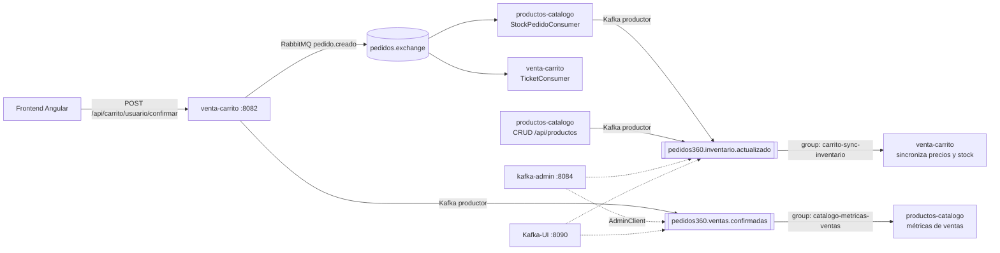

# Casos de uso Kafka – Pedidos360 (EP3)

Este documento define **qué flujos del sistema se implementan con Kafka, por qué, y cómo conviven con RabbitMQ**.
Es la base para la configuración de tópicos, los DTO, los productores/consumidores y el microservicio `kafka-admin`.

## 1. Criterio de diseño: ¿RabbitMQ o Kafka?

El sistema ya usa RabbitMQ (EP2) y **esa integración no se modifica**. Kafka se agrega para lo que RabbitMQ no resuelve bien:

| | RabbitMQ (se mantiene) | Kafka (nuevo) |
|---|---|---|
| Rol | **Cola de trabajo / comandos**: "haz esto una vez" | **Log de eventos / streaming**: "esto pasó" |
| Mensaje tras consumirse | Se elimina (ACK) | **Se conserva** según la retención; varios grupos pueden leerlo y releerlo |
| Uso en Pedidos360 | Descontar stock y generar ticket (`pedido.creado`) | Analítica de ventas y sincronización del estado del inventario |
| Errores | DLX + DLQ por cola | Reintentos con backoff + tópico `.DLT` por tópico |

**Regla:** una tarea que debe ejecutarse **exactamente una vez** se mantiene en RabbitMQ. Un **hecho de negocio** que pueden necesitar muchos interesados, ahora o a futuro (analítica, auditoría, caches), va a Kafka.

## 2. Arquitectura

Clúster local: **3 brokers + Zookeeper**, por eso los tópicos usan factor de replicación 3.

---

## 3. Caso de uso 1 – Analítica de ventas confirmadas

**Tópico:** `pedidos360.ventas.confirmadas`

| Elemento | Definición |
|---|---|
| Problema que resuelve | El negocio quiere saber **qué productos se venden más** (unidades y monto) sin consultar la BD transaccional del carrito, que se vacía al confirmar. |
| Productor | `venta-carrito`, al confirmar un pedido (`CarritoService.confirmarPedido`). Publica **después del commit** de la transacción: si Kafka falla, la venta no se pierde (se registra en el log). |
| Clave (key) | `usuarioId`: los eventos de un mismo cliente van a la misma partición y conservan su orden. |
| Consumidor | `productos-catalogo`, `@KafkaListener` en el grupo **`catalogo-metricas-ventas`** con `concurrency = 3`, es decir, un hilo por partición (balanceo de carga). |
| Procesamiento | Por cada ítem acumula `unidadesVendidas` y `montoVendido` por producto en la tabla `metricas_venta_producto`. Es **idempotente**: guarda el `eventoId` procesado para no contar dos veces una venta reentregada. |
| Salida visible | `GET /api/productos/mas-vendidos?top=5`, que el frontend muestra como sección "Más vendidos". |
| Por qué Kafka | La retención de 7 días permite **reprocesar** (por ejemplo, reconstruir las métricas desde cero reseteando el offset del grupo) y que otros grupos se sumen después (auditoría, BI) sin tocar al productor. |

**Configuración del tópico**

| Parámetro | Valor | Justificación |
|---|---|---|
| `partitions` | 3 | Paraleliza el consumo: 3 consumidores del grupo |
| `replication.factor` | 3 | Una copia por broker |
| `min.insync.replicas` | 2 | Con `acks=all` tolera la caída de 1 broker sin perder ventas |
| `cleanup.policy` | `delete` | Son hechos históricos; se borran por antigüedad |
| `retention.ms` | `604800000` (7 días) | Ventana para reprocesar y auditar |

---

## 4. Caso de uso 2 – Sincronización del estado del inventario

**Tópico:** `pedidos360.inventario.actualizado`

| Elemento | Definición |
|---|---|
| Problema que resuelve | `venta-carrito` guarda el precio de cada ítem al momento de agregarlo. Si el catálogo cambia el precio o el producto se agota, el carrito muestra datos **desactualizados**. |
| Productores | `productos-catalogo` en dos puntos: **(a)** al descontar stock por un pedido (dentro de `StockPedidoConsumer`, que sigue llegando por RabbitMQ) y **(b)** al crear, actualizar o eliminar un producto vía `/api/productos`. |
| Clave (key) | `productoId`: todos los cambios de un producto quedan en orden en la misma partición, requisito para la compactación. |
| Consumidor | `venta-carrito`, `@KafkaListener` en el grupo **`carrito-sync-inventario`**. |
| Procesamiento | Actualiza `precioUnitario` y `total` de los ítems en carrito de ese producto y marca `disponible = false` si `stockActual = 0`. |
| Salida visible | `GET /api/carrito/{usuarioId}` devuelve precios vigentes y el aviso "sin stock"; el frontend lo muestra. |
| Por qué Kafka | Con **compactación** el tópico se comporta como una tabla con el *último estado de cada producto*: un servicio nuevo puede leerlo desde el inicio y reconstruir el inventario completo. RabbitMQ no ofrece esto. |

**Configuración del tópico**

| Parámetro | Valor | Justificación |
|---|---|---|
| `partitions` | 3 | Distribuye los productos por clave |
| `replication.factor` | 3 | Una copia por broker |
| `min.insync.replicas` | 2 | Tolera la caída de 1 broker |
| `cleanup.policy` | `compact` | Solo importa el último estado por `productoId` |
| `min.compaction.lag.ms` | `60000` | Deja 1 min a los consumidores antes de compactar |
| `segment.ms` | `3600000` (1 h) | Segmentos cortos para que la compactación sea visible en la demo |
| `delete.retention.ms` | `86400000` (1 día) | Tiempo que se conservan los tombstones de productos eliminados |

---

## 5. Manejo de errores (ambos tópicos)

| Situación | Tratamiento |
|---|---|
| JSON mal formado (no deserializa) | `ErrorHandlingDeserializer`: no rompe el listener; va **directo al DLT**, sin reintentos |
| Payload inválido (falta `productoId`, cantidad ≤ 0, etc.) | Validación del DTO con `@Valid`. Es un error no recuperable: **DLT** sin reintentos y log con el contenido |
| Error recuperable (BD caída momentáneamente) | `DefaultErrorHandler` con **3 reintentos, backoff exponencial 1 s → 2 s → 4 s**; si persiste, va al DLT |
| Evento duplicado | Idempotencia por `eventoId` |

Tópicos DLT: `pedidos360.ventas.confirmadas.DLT` y `pedidos360.inventario.actualizado.DLT` (1 partición, RF 3, `delete`, retención 14 días). Cada mensaje enviado al DLT queda registrado en el log con tópico, partición, offset y causa.

## 6. Microservicio `kafka-admin` (puerto 8084)

Equivalente a `rabbitmq-admin`, usa `AdminClient` y está protegido con JWT de Azure AD:

| Operación | Endpoint |
|---|---|
| Listar tópicos | `GET /api/kafka/topicos` |
| Detalle (particiones, réplicas, líderes, ISR) | `GET /api/kafka/topicos/{nombre}` |
| Crear tópico con configuraciones | `POST /api/kafka/topicos` |
| Aumentar particiones | `PATCH /api/kafka/topicos/{nombre}/particiones` |
| Ver / modificar configuraciones (retención, cleanup…) | `GET`/`PUT /api/kafka/topicos/{nombre}/configuraciones` |
| Eliminar tópico | `DELETE /api/kafka/topicos/{nombre}` |
| Listar consumer groups | `GET /api/kafka/grupos` |
| Detalle de un grupo (miembros, offsets y lag) | `GET /api/kafka/grupos/{groupId}` |
| Resetear offsets de un grupo (reprocesar) | `POST /api/kafka/grupos/{groupId}/reset-offsets` |
| Eliminar un consumer group | `DELETE /api/kafka/grupos/{groupId}` |
| Listar brokers del clúster | `GET /api/kafka/cluster` |

## 7. Resumen de tópicos y grupos

| Tópico | Productor | Consumer group → servicio | Key | Part. | RF | Política |
|---|---|---|---|---|---|---|
| `pedidos360.ventas.confirmadas` | venta-carrito | `catalogo-metricas-ventas` → productos-catalogo | usuarioId | 3 | 3 | delete, 7 d |
| `pedidos360.inventario.actualizado` | productos-catalogo | `carrito-sync-inventario` → venta-carrito | productoId | 3 | 3 | compact |
| `*.DLT` | error handlers | (inspección en Kafka-UI) | original | 1 | 3 | delete, 14 d |

El formato JSON de cada mensaje se define en [modelo-mensajes.md](modelo-mensajes.md) (tarea 1.3).
